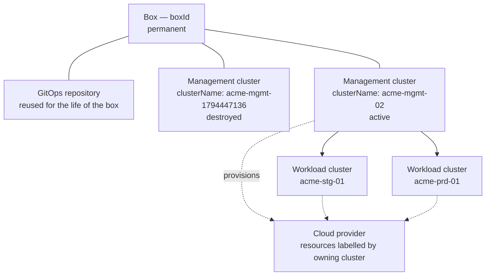

> A box outlives its clusters. That single idea explains every name, every refusal and every lifecycle below.

This page defines the words the platform uses for boxes and clusters, and the rules that hold between them. Each guide and command page assumes these.

## How the pieces relate



One box. One repository. Many management clusters over its life, **at most one of them holding infrastructure at a time**. The clusters it manages are declared in the same repository.

## Identity

Two names, with different lifetimes. They are separate fields in `registry/clusters/<cluster>/values.yaml` because one value could not do both jobs.

### Box

A box is a customer's installation of the platform: one cloud account, one GitOps repository, one identity. It is named by **`boxId`**, which is written once and never changed. It keys everything that must survive a cluster being replaced:

- the escrow path holding this box's master keys and its identity provider's encryption key
- the DNS records this box owns, through `dns.ownerId`
- the public hostnames applications are served on

### Management cluster

The management cluster runs the platform: the GitOps engine, cluster lifecycle, secrets, identity, login and observability. It is named by **`clusterName`**, and that name belongs to **this incarnation** of the cluster rather than to the box. It keys:

- the cluster's own object and node names
- the WAL archive prefix for its database

A box may have several management clusters across its life. Each is a new `clusterName` under the same `boxId`, so a replacement never writes into its predecessor's archive and never overwrites its predecessor's recovery credentials.

<Note>
A box and its first management cluster are named from the same timestamp when the box is initialized, such as `acme-1794447136` and `acme-mgmt-1794447136`. They are two values, and they diverge further the moment you replace the cluster. `boxId` is the one that stays.
</Note>

### Workload cluster

A cluster the management cluster creates and manages, where your applications run. Its identity outlives every management cluster: its PKI, its kubeconfig and its encryption key are keyed to the workload cluster itself, never to whichever management cluster currently manages it.

### Environment

An environment is a workload concern — `dev`, `stg`, `prod` — and it belongs to your applications, not to a cluster. Application declarations under `environments/` are untouched when a management cluster is replaced.

## Declarations

### The repository is the box's record

One GitOps repository is one box, and it is reused for the life of the box. It is created once, by `kakt box init`, and never created again — a replacement cluster is an edit to the repository that already exists.

### A declaration is not an existence

A cluster is declared by a file. The file says the cluster is **wanted**; it never says the cluster **exists**. Declarations deliberately outlive the clusters they describe, which is why the platform never reads one as proof that infrastructure is running.

### A workload cluster exists because its claim does

A workload cluster is declared by one file:

```
registry/clusters/<cluster>/infrastructure/spokepool.yaml
```

The management cluster watches that path and generates two Applications per cluster — one for the claim, one for the artifacts the cluster's own Day-0 writes. Creating the file creates the cluster. Removing the file removes it. There is no second step and no destroy command: **committing is the removal**.

`kakt tenant add-cluster` writes the claim. `kakt tenant remove-cluster` deletes it.

## Lifecycle

### Normal creation

The box has no management cluster holding infrastructure. You create the box, declare the cluster, and build it:

```bash
kakt box init --tenant acme --box acme-inc --domain acme.example
gh workflow run bootstrap-cluster -f cluster=acme-mgmt-1794447136
```

`boxId` is pinned here, at the box's first incarnation.

### Normal replacement

You are intentionally replacing the management cluster, and you are not preserving any running workload cluster. The order is fixed: workload clusters first, then the management cluster, then the new one.

```bash
# 1. remove each workload cluster — a commit each
kakt tenant remove-cluster --mgmt-cluster acme-mgmt-1794447136 --name acme-stg-01

# 2. destroy the management cluster
kakt teardown --name acme-mgmt-1794447136 --gitops-dir . --confirm

# 3. declare the replacement — boxId is untouched
kakt tenant add-management --name acme-mgmt-02

# 4. build it
gh workflow run bootstrap-cluster -f cluster=acme-mgmt-02
```

What survives: the repository, `boxId`, the box's escrow scope, the DNS records it owns, and every past incarnation's escrow artifacts and database archives. Nothing is deleted by hand and the repository is never re-created.

### Rebuilding after an unplanned loss

If a management cluster is lost unexpectedly, the box is rebuilt from what it kept outside that cluster: the repository, `boxId`, the escrow and the database archives. You declare a new management cluster, build it, and bring the workload clusters back under it.

The order is the same as a planned replacement — workload clusters first, then the management cluster — because the management cluster holds their Cluster API objects and is what deprovisions their load balancers. Creating one while they still hold infrastructure is refused, so the sequence stays correct even when the loss was not planned.

What survives either way: the repository, the box's identity, its escrow scope, the DNS records it owns, and every past cluster's escrow artifacts and database archives.

## Rules

### One management cluster per box

A box has at most one management cluster holding infrastructure. Two would reconcile the same declarations in the same repository, so each would provision the other's workload clusters under names already taken, and each would archive its database to a prefix the other is writing.

`bootstrap` establishes this before it provisions anything, and refuses with every blocker listed at once.

### The provider decides what exists

Existence is established from the cloud provider's own inventory, where every resource carries its owning cluster's name as a label. The other candidates are read for what they are good for and nothing else:

- a **declaration** in the repository outlives its cluster by design
- an **escrow artifact** is retained deliberately, for as long as its recovery point matters
- the **Kubernetes API** answers only while a cluster is healthy — and an unreachable API is also what a wedged cluster with running servers looks like

So a cluster that owns no labelled resource is verifiably destroyed, and one that owns any is present whether or not it answers. An inventory that cannot be read is refused rather than read as empty: an unreadable answer is the same evidence as an unasked question.

Because the provider's label names a cluster rather than a box, the names to ask about come from the box's own records — what the repository declares now, and every management cluster its history shows was ever declared. A cluster whose directory someone removed is still asked about.

### The management cluster goes last

It holds the Cluster API objects of every cluster it manages and is the only thing that can deprovision their load balancers. Destroying it first leaves them running, unmanaged and billing. Teardown refuses while any cluster it manages is still there, and so does the creation of a replacement.

### Retrying is not duplicating

Infrastructure owned by the cluster currently being built is an earlier attempt at the same one, so a repeated bootstrap continues it and says what it is resuming. Infrastructure owned by any other management cluster of the box is a duplicate, and is refused.

## Observing

`kakt tenant cluster-status --name <cluster> --mgmt-cluster <management-cluster>` reports what is actually there, with the evidence before the verdict:

- **declared** — the repository declares it; nothing has been built yet
- **deleting** — removal is under way
- **removed** — the provider was asked, and it owns nothing
- **failed** — nothing manages it any more and its resources are still running
- **unknown** — the state could not be established

`removed` requires the provider to have been asked. Removing a declaration from Git is never reported as a destroyed cluster.

## Related topics

- [Create a box](/guides/box/create-a-box)
- [Add a managed cluster](/guides/clusters/add-a-managed-cluster)
- [Remove a managed cluster](/guides/clusters/remove-a-managed-cluster)
- [Delete a box](/guides/box/delete-a-box)
- [Boxes and clusters CLI reference](/cli/boxes-and-clusters)
