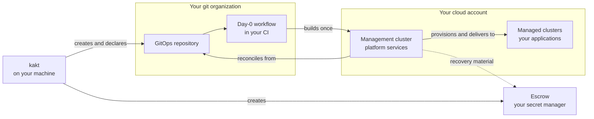

import { BoundaryStack } from "/snippets/boundary-stack.jsx";

## From installer to running platform



Three facts carry the rest of this page:

1. **The executable starts the setup.** `kakt` creates your escrow project and your GitOps repository, and declares the management cluster. Day-0, run once from your repository's own CI, builds that cluster.
2. **Everything runs in accounts you own.** The repository is in your git organization, the clusters are in your cloud account, and the escrow is in your secret manager. Every credential is one you supply, kept on your machine or as encrypted CI secrets on your repository, and Kamarkat's own services receive none of them.
3. **GitOps runs it afterwards.** Once Day-0 hands over, the GitOps engine on your management cluster reconciles the box from your repository. Every later change, including a platform upgrade, is a commit.

## Architecture overview

A Kamarkat deployment lives entirely in accounts you own: a git organization that holds the desired state, and a cloud account that runs the box. The box is a management cluster, which runs the platform's services, plus the managed clusters it creates, where your applications run. Kamarkat delivers the platform into the box, but holds no credential to it and no Kamarkat component connects into it.

Kamarkat's side is small: a release pipeline publishes bundle versions to a registry, and your box pulls them.

## Three layers, one product

```text
┌─ Agentic operations ──────────────────────────────────────────────────┐
│  Agents · MCP registry · Skills registry                              │
│  Engineers and AI agents, working through the same contracts          │
└───────────────────────────────────────────────────────────────────────┘
┌─ Integrated cloud-native platform OS ─────────────────────────────────┐
│  GitOps · Identity · Secrets · Databases · Gateway · Networking       │
│  Observability · Application delivery · Cluster lifecycle             │
└───────────────────────────────────────────────────────────────────────┘
┌─ Business-owned infrastructure ───────────────────────────────────────┐
│  Management cluster · Managed clusters · Cloud infrastructure         │
│  Storage · Networking                                                 │
└───────────────────────────────────────────────────────────────────────┘
```

The layers are one product, and the model is an operating one rather than a deployment diagram — it says how the parts relate, not where each component is scheduled.

The agentic layer is **not** a controller beside the platform with its own path to infrastructure. Agents read the same platform state engineers do, and changes to declarative desired state go through the same declarations and the same reconciliation — so GitOps stays authoritative for what the infrastructure and applications should be, and ownership is unchanged.

A box is two kinds of cluster, and every cluster has two kinds of node.

<div className="arch-sys not-prose">
<div className="arch-cl">
  <div className="arch-cl-git">
    <div className="arch-group">
      <span className="arch-label">Your git organization</span>
      <div className="arch-caps">
        <a className="arch-cap" href="/features/box/bundle"><span className="arch-icon arch-icon-neutral"><Icon icon="code-branch" /></span>GitOps repository</a>
        <a className="arch-cap" href="/features/workloads/deploying-applications"><span className="arch-icon arch-icon-neutral"><Icon icon="folder-open" /></span>Application repositories</a>
        <a className="arch-cap" href="/features/capabilities/cluster-lifecycle"><span className="arch-icon arch-icon-neutral"><Icon icon="terminal" /></span>Day-0 runner (your CI)</a>
      </div>
    </div>
    <div className="arch-inline-wire">
      <span className="arch-wire"></span>
      <span className="arch-wire-label">Desired state</span>
    </div>
  </div>

  <div className="arch-group arch-group-managed arch-cl-box">
  <span className="arch-label">Your box</span>
  <div className="arch-cl-row">
  <div className="arch-cl-cluster">
    <a className="arch-cl-title" href="/features/box/overview">Management cluster</a>
    <span className="arch-cl-sub">One per box. Operates the box.</span>
    <div className="arch-cl-node">
      <span className="arch-label">Control plane nodes</span>
      <span className="arch-cl-what">Kubernetes itself</span>
    </div>
    <a className="arch-cl-node arch-cl-node-main" href="/features/capabilities/overview">
      <span className="arch-label">Worker nodes</span>
      <span className="arch-cl-what">Platform services</span>
      <span className="arch-cl-detail">GitOps, cluster lifecycle, secrets, identity, login, observability, console</span>
    </a>
  </div>

  <div className="arch-cl-flows">
    <div className="arch-cl-flow">
      <a className="arch-wire-label" href="/features/capabilities/gitops-and-composition">Creates and reconciles</a>
      <span className="arch-wire arch-wire-h"></span>
    </div>
    <div className="arch-cl-flow">
      <a className="arch-wire-label" href="/features/capabilities/secret-management">Secrets, identity, login</a>
      <span className="arch-wire arch-wire-h"></span>
    </div>
    <div className="arch-cl-flow">
      <a className="arch-wire-label" href="/features/capabilities/observability">Metrics, logs, alerts</a>
      <span className="arch-wire arch-wire-h arch-wire-rev"></span>
    </div>
  </div>

  <div className="arch-cl-cluster">
    <a className="arch-cl-title" href="/features/workloads/environments">Managed clusters</a>
    <span className="arch-cl-sub">One or more per environment. Runs your apps.</span>
    <div className="arch-cl-node">
      <span className="arch-label">Control plane nodes</span>
      <span className="arch-cl-what">Kubernetes itself</span>
    </div>
    <a className="arch-cl-node arch-cl-node-main" href="/features/workloads/deploying-applications">
      <span className="arch-label">Worker nodes</span>
      <span className="arch-cl-what">Your applications</span>
      <span className="arch-cl-detail">with the local services they need: gateways, databases, agents</span>
    </a>
    <a className="arch-cl-node arch-cl-node-opt" href="/features/capabilities/cluster-lifecycle">
      <span className="arch-label">On-premises worker nodes · dev only</span>
      <span className="arch-cl-detail">Your own machines, joining over your tailnet</span>
    </a>
  </div>
  </div>
  </div>

  <div className="arch-caps arch-cl-escrow">
    <a className="arch-cap" href="/features/admin/escrow"><span className="arch-icon arch-icon-neutral"><Icon icon="vault" /></span>Break-glass escrow (outside the box)</a>
  </div>
</div>
</div>

Select any part to read about it.

- **Control plane nodes** run Kubernetes on every cluster. On a box with cloud workers they carry nothing else; a box declared with no cloud workers — `--workers 0`, where capacity comes from your own machines — runs with a schedulable control plane instead, and the platform's workloads do run there.
- **The management cluster's workers** run the platform's services, grouped into [capabilities](/features/capabilities/overview). Your applications are delivered to managed clusters rather than to the management cluster.
- **A managed cluster's workers** run your applications. A box may have **none** — a box is created with no clusters at all, its management cluster is declared next, and managed clusters are added when you declare them — in which case the box is complete with one cluster: see [Deploying applications](/features/workloads/deploying-applications). The management cluster creates each managed cluster, then delivers its platform and your apps to it; the managed cluster reads its secrets and identities from the management cluster and reports its telemetry back.

To see every component on each node type, open any version under [Releases](/versions/lines/0-1).

## Deployment boundaries

Nothing in a box is deployed all at once. Each cluster is built in layers called **boundaries**, and each boundary is applied only when the one beneath it is in place. Select a layer to see what it deploys.

<BoundaryStack />

On the management cluster, Day-0 lays the foundation once and hands over to the GitOps engine, which then reconciles every boundary above it from your GitOps repository. A managed cluster receives its foundation as it is created; from then on the management cluster delivers its platform services, its shared gateway and your applications.

A selectable capability is part of its boundary only when you select it in your cluster's values.

## Components

The platform's services are grouped into capabilities. What each one gives you, and the open-source projects it is built on, is on its page under [Capabilities](/features/capabilities/overview). Your git organization's part is described in [Git connection](/features/admin/git-connection), and the break-glass escrow in [Escrow](/features/admin/escrow).

## Supported topology

| Environment | `hetzner` | `hybrid` |
| :- | :- | :- |
| `dev` | Supported | Supported |
| `stg` | Supported | Not supported |
| `prod` | Supported | Not supported |

`hybrid` runs cloud control-plane nodes with worker nodes on your own machines, joining over your tailnet, and it is supported for `dev` only. Staging rehearses production, and production runs on `hetzner`. Unsupported combinations are refused when the cluster is declared and again when the chart renders — see [Providers per environment](/features/workloads/environments#providers-per-environment).

## Connectivity model

Four kinds of connection cross the edge of your accounts. Each has a different direction and runs under different credentials.

| Connection | Direction | Credentials |
| :- | :- | :- |
| **Published artefacts** | Your machine, your CI and your clusters download from Kamarkat's public release page and registry: the `kakt` CLI, the pinned Day-0 workflow, the bundle chart and the platform's images | None. The artefacts are public |
| **Provider API calls** | `kakt` and Day-0 call your cloud provider, your git host and your escrow secret manager to build and run the box | Yours, supplied by you |
| **Upgrade proposals** | The upgrade automation configured in your repository reads which bundle versions are published, and opens a pull request in your repository | Whatever you grant that automation. It never merges a platform upgrade on its own |
| **Support reporting** | Nothing, until you enrol. An enrolled box sends an allowlisted set of cluster facts outward. `kakt support scope` lists every field, and `kakt support preview` shows the exact payload | The enrolment certificate. Removing it unenrols the box |

**Inbound to your box:** nothing. No Kamarkat component opens a connection into a box, holds a credential for one, or queries one.

Stopping using Kamarkat stops nothing that is running: your box does not need Kamarkat to be reachable to keep serving. Building new clusters and taking upgrades still pull the published artefacts from the registry each cluster's `bundle.yaml` names.

## Delivery and upgrades

**Day-0** runs once, from your CI, under your credentials. It creates the management cluster, brings up any managed cluster your repository already declares, and commits the facts it discovers to your GitOps repository. After that, **the repository is the only authority** for the box.

**Platform upgrades** are a change to one version field in the cluster's own declaration. A pre-flight check runs inside your box against the target cluster and reports its verdict. Nothing changes until that change reaches the branch your management cluster reconciles.

**Application releases** follow the same shape. Your application's build publishes its chart and commits the new version to your GitOps repository, and the GitOps engine deploys it.

See [The Bundle](/features/box/bundle), [Versioning](/versions/overview) and [Deploying Applications](/features/workloads/deploying-applications) for details.

## Data residency

Nothing your box stores is sent to Kamarkat. Support reporting, if you enrol, sends only the allowlisted cluster facts described [above](#connectivity-model). Workload data, application logs, database contents, secret material and end-user identifiers stay in accounts you control.

Within the box, a managed cluster **reports its telemetry to the management cluster**, which is where metrics, logs and dashboards are aggregated. That is how the box is designed, not an exception to it.

Three destinations are outside the clusters, and all three are yours:

| Destination | What goes there | Who owns it |
|---|---|---|
| Object storage | database backups and management-state archives | your storage account |
| Escrow secret manager | the recovery artefacts a box cannot keep itself ([Escrow](/documentation/escrow/overview)) | your escrow secret manager account |
| Alert endpoint, if you configure one | alert notifications and a heartbeat | the provider you point it at |

So data residency is a property of where **you** put those destinations. The platform sends nothing anywhere you have not configured, and nothing to Kamarkat unless you enrol support reporting.
